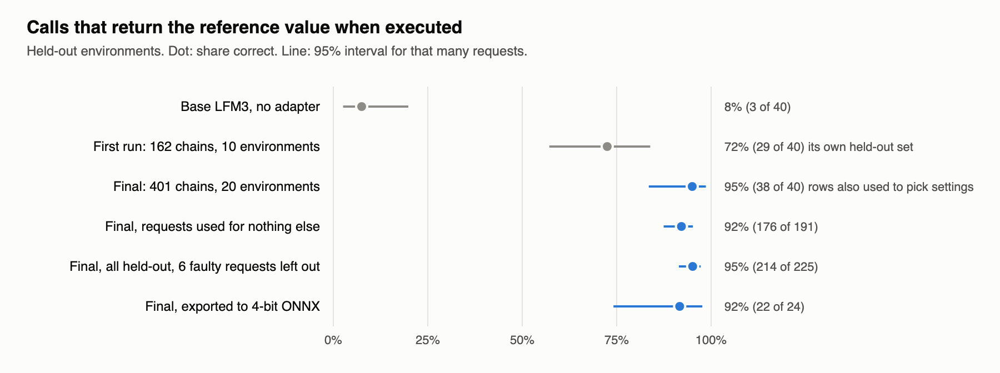
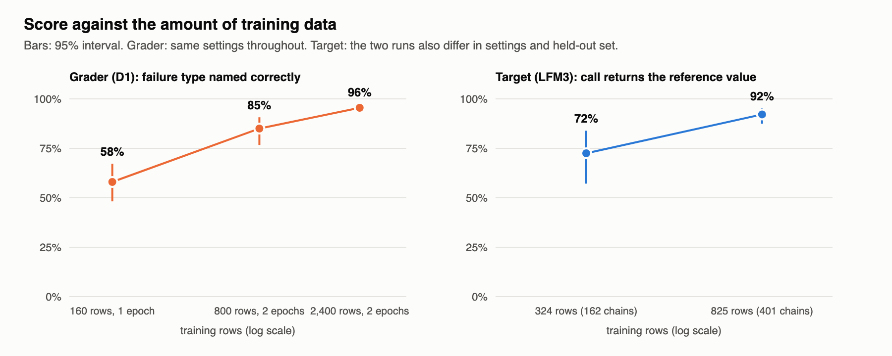
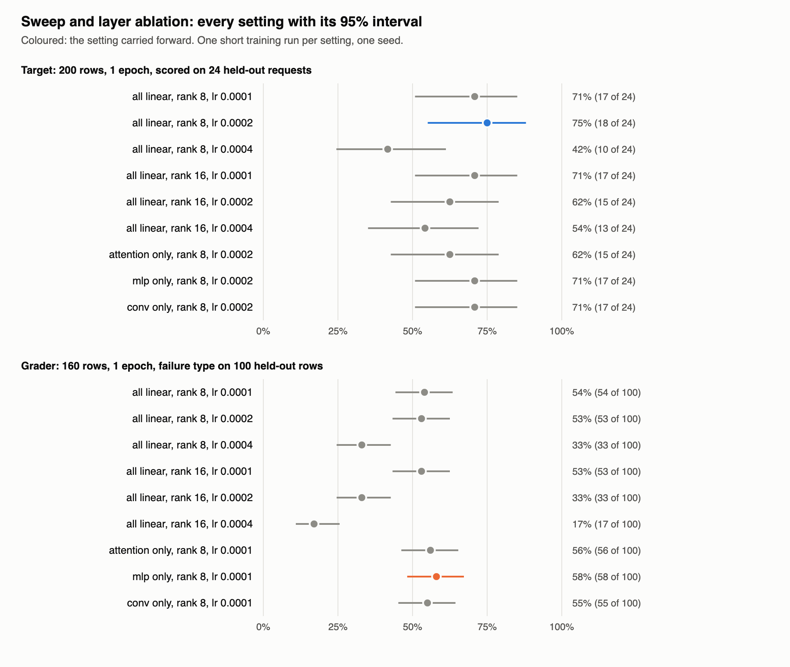
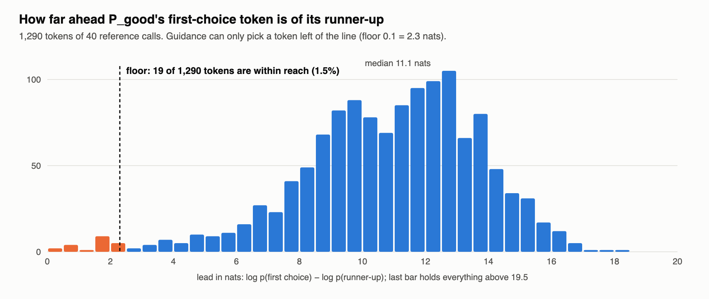
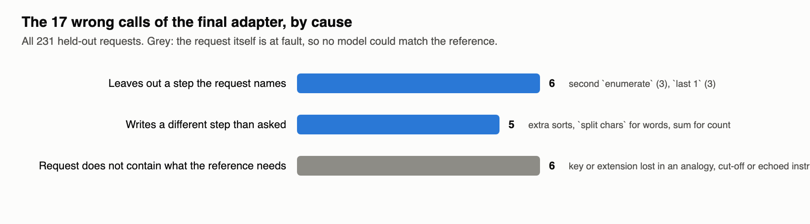

# Nushell tool calls: data and conclusions

Notes for the lab notebook. Numbers are from the saved reports in `runs/` (dataset `edd14fe576df`: 20 generated environments, 401 chains, 3 requests each, 4 environments held out whole). Charts are redrawn with `scripts/make_note_charts.py`.

## 1. Result

- A call counts as correct only if executing it returns the reference value.
- Base LFM3 1.7B: 3 of 40 held-out requests (8%).
- Final adapter on all 231 held-out requests: 214 correct, 17 wrong.
- 6 of the 17 wrong calls are requests that do not contain what the reference call needs (listed in section 5). No decoder could match the reference from those requests.
- Leaving those 6 out: **214 of 225 (95%; 95% interval 91–97%)**.
- With them in, on the 191 requests that were used for nothing else: 176 of 191 (92%; 95% interval 87–95%).
- The 6 were found by reading the wrong calls. The 214 correct calls were not read the same way, so faulty requests the model happened to answer correctly are still counted. A pattern for echoed instructions flags 8 of the 231 held-out requests; 2 of those 8 are among the wrong calls.
- The same adapter on the 40 requests every decoder was run on: 38 of 40 (95%). 24 of those 40 were also used to pick settings.
- After export to 4-bit ONNX: 22 of 24. The 8-bit MLX adapter gets the same 22 of the same 24.
- In the browser on WebGPU: 54 of 60.
- Grader (D1 2B), final adapter on 400 held-out rows: failure type 96%, broken or not 97%, span found 94%. On the 200 broken rows alone the failure type is right for 92.5%. Base model: 27% and 61%.

## 2. Data size and settings

- Grader, failure type named correctly: 58% at 160 rows, 85% at 800 rows, 96% at 2,400 rows. Error rate 42% → 15% → 4%.
- The three grader points are not a clean series: the 160-row run is 1 epoch and the others 2; the first two were scored on 100 rows and the last on 400.
- Target: 72% with 162 chains (324 fitted rows), 92% with 401 chains (825 fitted rows). The two runs have different held-out environments and different chosen settings, so this is two points, not a curve.
- In the first run, 4 of 11 wrong calls were `open --raw` on a JSON file. The training split of that run had 5 chains that open JSON.

- Target sweep (24 requests): 75%, 71%, 71%, 62%, 54%, 42%. Layer ablation at the chosen setting: all linear 75%, MLP only 71%, convolution only 71%, attention only 62%.
- The chosen setting differed between the two runs. Target: rank 16, lr 1e-4, then rank 8, lr 2e-4. Grader: all linear, rank 16, then MLP only, rank 8.
- lr 4e-4 gave the lowest grader scores in both runs, and the two lowest target scores in the second run.
- Every setting was trained once, with one seed. Seed-to-seed variation was not measured.

How many requests a comparison needs (standard error √(p(1−p)/n), p ≈ 0.75, two settings compared):

| Requests scored | 95% half-width on one score | Smallest difference between two settings that is outside noise |
|---|---|---|
| 24 (the sweep) | ±17 points | about 25 points |
| 40 | ±13 | about 19 |
| 231 (all held-out) | ±5.6 | about 8 |
| 600 | ±3.5 | about 5 |
| 1,200 | ±2.5 | about 3.5 |

- With 24 requests, the 33-point gap between 75% and 42% is outside noise. The gaps among 75, 71 and 62 are not.
- Scoring both settings on the same requests roughly halves the requests needed when their errors fall on the same items.
- Scoring 191 requests took about ten minutes on this machine.

## 3. Guidance

Guided decoding scores a token x by

    log p_w(x) = log p_good(x) + w · [log p_good(x) − log p_other(x)],   over x with p_good(x) ≥ f · p_good(a)

where a is P_good's first choice. A runner-up b replaces a only if both hold:

    m ≤ ln(1/f)          m = log p_good(a) − log p_good(b), the lead
    w · d > m            d = [log p_good(b) − log p_other(b)] − [log p_good(a) − log p_other(a)], the push

- With f = 0.1 the first condition is m ≤ 2.30 nats, i.e. p(a)/p(b) ≤ 10. If a and b hold nearly all the probability, that is p(a) ≤ 0.91.
- Measured mean |d| against P_bad is 2.5 nats. At w = 0.5 a typical flip needs m < 1.25 nats, i.e. p(a)/p(b) < 3.5, i.e. p(a) below about 0.78.
- Measured lead over 1,290 tokens of the 40 scored calls (read along the reference call):

| Quantile | Lead (nats) | Odds, first choice : runner-up |
|---|---|---|
| 5% | 5.9 | 365 : 1 |
| 25% | 9.1 | 9,000 : 1 |
| 50% | 11.1 | 66,000 : 1 |
| 75% | 12.8 | 350,000 : 1 |

- Tokens with a second token inside the floor: 19 of 1,290 at f = 0.1 (1.5%); 27 at f = 0.03; 6 at f = 0.3.
- P_good's first choice differs from the reference token at 7 tokens. Its lead at those 7: 0.1, 0.6, 0.6, 1.4, 2.4, 3.0 and 13.3 nats.
- So 4 of the 19 tokens inside the floor are places where P_good departs from the reference (21%), against 3 of the other 1,271 (0.2%). The departures sit where the lead is small.
- Guidance therefore reaches most of the departures (4 of 7 at f = 0.1, 6 of 7 at f = 0.03). What it lacks is direction: steering away from P_bad moved 1 token onto the reference and 2 away.
- Tokens guidance changes at w = 0.5, f = 0.1:

| Steered away from | Changed | Away from the reference | Onto the reference |
|---|---|---|---|
| P_bad | 3 | 2 | 1 |
| P_good a quarter of the way through training | 4 | 1 | 3 |
| Base model | 4 | 1 | 3 |

- Without the floor, flipping a median token needs w > 11.1 / 2.5 ≈ 4.4. The reference call's log-probability per token under guidance away from P_bad is −0.017 at w = 0, −0.040 at w = 0.5, −0.094 at w = 1 and −0.39 at w = 2.
- On whole calls: P_good is wrong on 2 of 40 (ε = 0.05). Guidance gains only if P(fix | wrong) / P(break | right) > (1 − ε)/ε = 19.
- Executed scores of the eight guided decoders on the 40 requests: 92–95%, against 95% unguided.
- P_bad's training data: 3 of P_good's own wrong calls (from 48 probes) and 157 generated breaks. In the first run: 10 own and 150 generated.
- Grader: guidance changed failure-type accuracy by at most half a point in either scheme.

## 4. Data and environments

How the data is built:

- Each environment is a small project generated from a seed (files, logs, a JSON table, a TOML config). 20 environments; 16 for training, 4 held out whole.
- A chain is a source followed by stages whose input type matches the previous output. 401 chains were kept after running each one.
- Each chain has 3 requests written by the base LFM3 model in one of six styles. 935 of 1,203 requests are model-written; 268 (22%) failed a check and fell back to a description composed from the chain's steps.
- Broken variants for the grader come from ten failure types; 4,329 broken calls and 483 equivalent answers alongside 1,740 correct calls.

What the data showed about itself:

- Coverage by pattern. Category shares came from usage data. Nothing counted chains per source-and-operation pattern. JSON files had 5 training chains in the first run.
- Requests are checked less than commands. Commands are executed; requests are checked by a pattern for kept terms.
  - The first check accepted "document" as keeping `doc`, so bare folder names were lost in rewrites.
  - About 4% of requests (47 of 1,203 by pattern) repeat part of the rewriting instruction.
  - 6 of the 17 remaining wrong calls are requests that do not contain what the reference needs.
- Reference values depend on the machine. Three sources: the order `glob` returns entries (directory order on disk), the size `ls` reports for a directory, and the time zone of modified times.
  - Found by running every sample in the WebAssembly Nushell as well: 535 of 580 correct calls matched at first.
  - After adding `path type` and matching directory sizes: 561 of 580 match, and the other 19 differ only in `glob` order.
- Held out by project, not by pattern. Of the 77 held-out chains, 15 have a command identical to a training command, 50 follow a pattern that also occurs in training, and 27 are new combinations of familiar steps (counted in the independent review).
- One reference value per request. A different answer that also satisfies the request counts as wrong. How often that happens was not measured.
- Failure types came from the design, not from observed errors. The target's observed errors are a dropped step, a neighbouring command, and a guessed key name.
- Composed fallback requests are in the evaluation set too. They list the steps in order.
- Evaluation sizes (24 for sweeps, 40 for the comparison) were set before any effect sizes were known.

## 5. The remaining wrong calls

All 17 wrong calls of the final adapter on the 231 held-out requests, read one by one:

| Cause | Count | Examples |
|---|---|---|
| Leaves out a step the request names | 6 | the second of two `enumerate` steps (3); `last 1` before a status report (3) |
| Writes a different step than asked | 5 | a different ending after `get level` in the log-count chain (3); `split chars` for "words" (1); sums sizes when asked to count entries (1) |
| Request does not contain what the reference needs | 6 | analogy drops the key name `max_connections` (2); analogy drops the `.toml` extension (1); request is cut off after two steps (1); request is the rewriting instruction itself (1); request asks for names and hits, reference returns a count (1) |

- Leaving out the 6 requests in the last row, the final adapter is correct on 214 of 225 (95%). This is the figure used in section 1.
- The 11 model-side errors come from 5 chain patterns.
